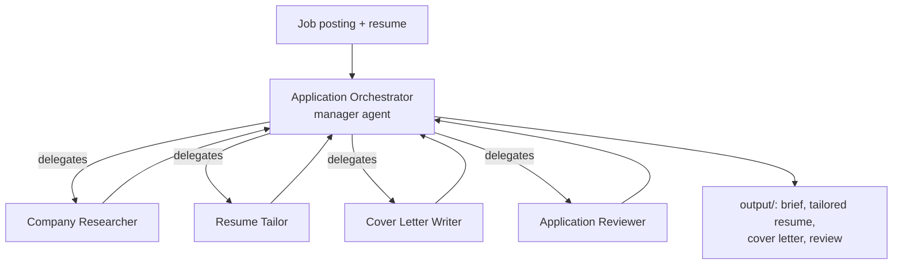

# OfferPilot

**A multi-agent job application assistant built with CrewAI.**

Give OfferPilot a job posting and your resume. An orchestrator agent plans the work and delegates it to a crew of specialist agents, which research the company, tailor your resume, write a cover letter, and review everything for accuracy.

## Architecture



The crew runs as a **hierarchical process**: tasks have no fixed owner, and the orchestrator decides which specialist handles each one, checks the result, and moves on.

Company research and resume tailoring don't depend on each other, so they **run in parallel**. The cover letter waits for both and uses their results.

| Agent | Job |
|---|---|
| Application Orchestrator | Plans the work, delegates, and checks quality |
| Company Researcher | Scrapes and searches the web for the company's focus, top skills, and keywords, and cites sources |
| Resume Tailor | Rewrites resume bullets to match the role, without inventing anything |
| Cover Letter Writer | Writes a specific, one-page letter |
| Application Reviewer | Flags invented claims, missing keywords, and tone issues |

## Quick start

```bash
git clone https://github.com/<you>/offerpilot.git
cd offerpilot
python -m venv .venv && source .venv/bin/activate
pip install -e ".[dev]"
cp .env.example .env        # then paste your Anthropic API key into .env
offerpilot --job inputs/sample_job.md --resume inputs/sample_resume.md

# or point it at a live posting
offerpilot --job https://example.com/careers/some-job --resume my_resume.md
```

For live web search, add a free `SERPER_API_KEY` from [serper.dev](https://serper.dev) to `.env`. Without it, the researcher can still read web pages.

Results are written to `output/`.

## Run the tests

```bash
pytest
```

## Roadmap

- [x] Step 1: Hierarchical crew with an orchestrator and four specialists
- [x] Step 2: Web research tools, reading postings from a URL, and parallel research and tailoring
- [ ] Step 3: A review loop (CrewAI Flow) that sends flagged work back for revision
- [ ] Step 4: A polished CLI and demo

## Tech

Python · CrewAI · Anthropic Claude
