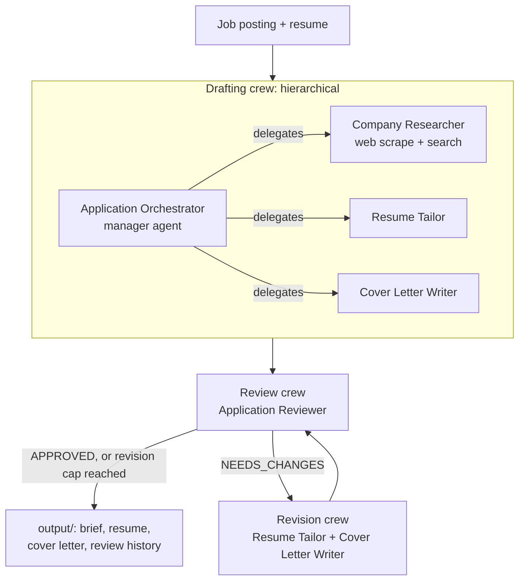

# OfferPilot

**A multi-agent job application assistant built with CrewAI.**

Give OfferPilot a job posting and your resume. An orchestrator agent plans the work and delegates it to a crew of specialist agents, which research the company, tailor your resume, write a cover letter, and review everything for accuracy.

## Architecture

OfferPilot is a **CrewAI Flow** that connects three crews into a draft, review and revise loop.



1. **Draft.** In the drafting crew, the orchestrator decides which specialist handles each task. Company research and resume tailoring **run in parallel**, and the cover letter waits for both.
2. **Review.** The reviewer returns a **structured verdict** (a Pydantic model): `APPROVED` or `NEEDS_CHANGES`, a score out of 10, and separate issue lists for the resume and the cover letter.
3. **Revise.** The flow's router sends each issue list back to the agent who wrote that piece, then reviews again. Revisions are **capped at 2**, so the loop always ends.

| Agent | Job |
|---|---|
| Application Orchestrator | Plans the draft and delegates to specialists |
| Company Researcher | Scrapes and searches the web for the company's focus, top skills, and keywords, and cites sources |
| Resume Tailor | Rewrites resume bullets to match the role without inventing anything, then fixes flagged issues |
| Cover Letter Writer | Writes a specific one-page letter, then fixes flagged issues |
| Application Reviewer | Flags invented claims, missing keywords, and tone issues, and approves or sends work back |

## Quick start

```bash
git clone https://github.com/<you>/offerpilot.git
cd offerpilot
python -m venv .venv && source .venv/bin/activate
pip install -e ".[dev]"
cp .env.example .env        # then pick a model and add its key (see below)
offerpilot --job inputs/sample_job.md --resume inputs/sample_resume.md

# or point it at a live posting
offerpilot --job https://example.com/careers/some-job --resume my_resume.md
```

For live web search, add a free `SERPER_API_KEY` from [serper.dev](https://serper.dev) to `.env`. Without it, the researcher can still read web pages.

Results are written to `output/`, including `review.md` with every review round.

## Choosing a model (free options included)

OfferPilot works with any model CrewAI supports. Set `OFFERPILOT_MODEL` in `.env`:

| Option | `OFFERPILOT_MODEL` | Cost | Key |
|---|---|---|---|
| Google Gemini | `gemini/gemini-flash-latest` | Free tier, with rate limits | `GEMINI_API_KEY` from [Google AI Studio](https://aistudio.google.com/apikey) |
| Ollama (local) | `ollama/qwen3:8b` | Free, runs on your machine | None. Install [Ollama](https://ollama.com) and run `ollama pull qwen3:8b` |
| Anthropic Claude | `anthropic/claude-sonnet-5-5` | Paid | `ANTHROPIC_API_KEY` from [Anthropic Console](https://console.anthropic.com) |

Small local models can struggle with the orchestrator's delegation step. If a local run gets stuck, try Gemini.

## Run the tests

```bash
pytest
```

## Roadmap

- [x] Step 1: Hierarchical crew with an orchestrator and four specialists
- [x] Step 2: Web research tools, reading postings from a URL, and parallel research and tailoring
- [x] Step 3: A review loop (CrewAI Flow) that sends flagged work back for revision
- [ ] Step 4: A polished CLI and demo

## Tech

Python · CrewAI · Gemini / Claude / Ollama
